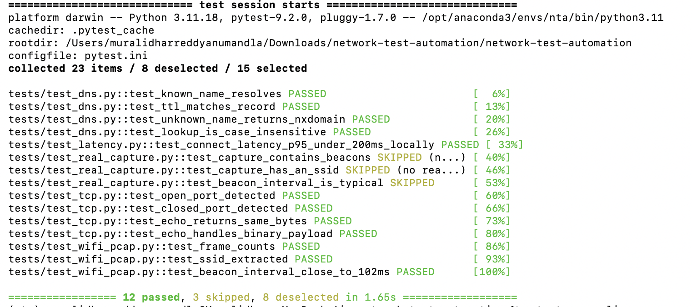
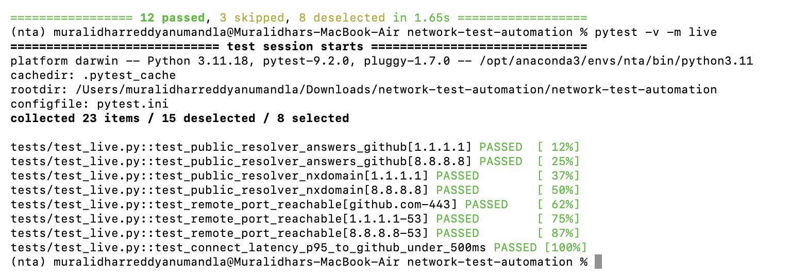
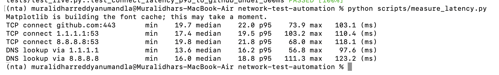
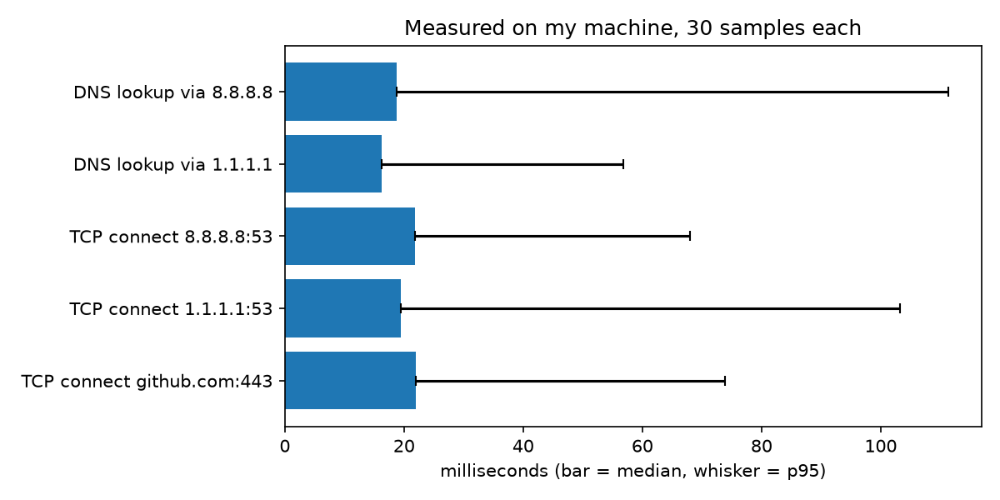
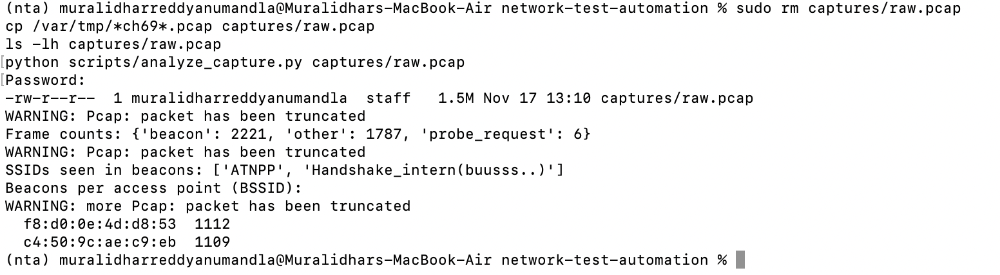
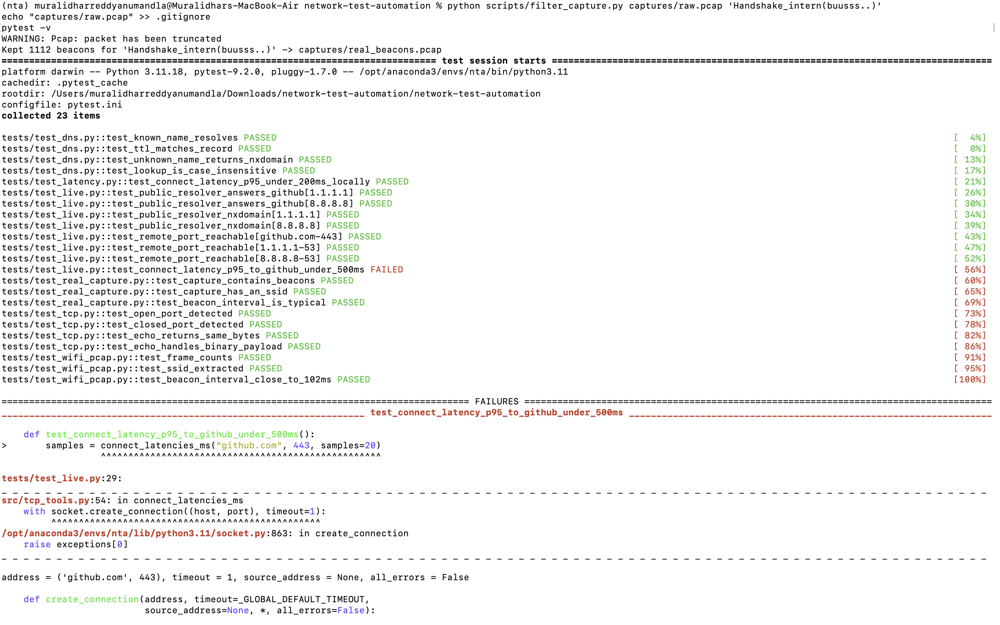
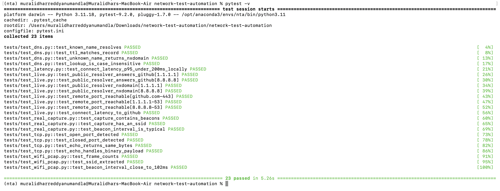

# network-test-automation

A small pytest suite that tests network behavior: a local DNS server, TCP port and echo checks, connect latency, and 802.11 frame analysis.

Everything runs locally. The DNS and TCP servers are started by the tests, and the 802.11 capture is generated with scapy, so it is not a real over-the-air capture.

## Run
```
pip install -r requirements.txt
pytest -v
```

## Contents
- `src/` the code under test (DNS server, TCP helpers, pcap analysis)
- `tests/` 12 pytest tests
- `TEST_PLAN.md` scope, test cases, entry and exit criteria
- `BUG_REPORT_TEMPLATE.md` template for reporting failures
- `.github/workflows/ci.yml` runs the tests on every push

## Results on real hardware (MacBook Air, home Wi-Fi, 2026-11-17)

- Local tests: 
- Live DNS and TCP tests against 1.1.1.1, 8.8.8.8 and github.com: 
- Measured latency, 30 samples each:  
- Real 802.11 capture (2,221 beacons from 2 access points, 60 seconds): 
- Real beacons from my own network were used for REAL-1 and REAL-2. The raw capture is not published because it contains other people's network data.

## Bug found by running on real hardware

BUG-001: one dropped connect made the live latency test fail. See `docs/BUG-001-live-latency-timeout.md`.
Before the fix:  After the fix: 
